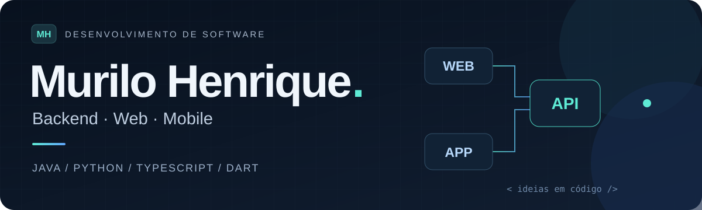

  

  <a href="#foco-atual-inteligência-artificial">Foco em IA</a> &nbsp; · &nbsp;
  <a href="#projetos-em-destaque">Projetos em destaque</a> &nbsp; · &nbsp;
  <a href="#tecnologias">Tecnologias</a> &nbsp; · &nbsp;
  <a href="https://github.com/murilohenrique25?tab=repositories">Todos os repositórios</a>

## Olá, eu sou o Murilo 👋

Minha atuação atual está focada em **Inteligência Artificial aplicada**, com **RAG, LangChain, LangGraph e pgvector**. Trabalho na conexão entre modelos de linguagem, dados e aplicações para transformar informação em recursos úteis para o dia a dia.

Minha base em **backend, web e mobile** complementa esse trabalho: das APIs e dos bancos de dados até as interfaces que colocam a IA nas mãos de quem usa.

## Foco atual: Inteligência Artificial

- **RAG e bases de conhecimento:** recuperação de contexto para aplicações com modelos de linguagem.
- **LangChain e LangGraph:** integração de LLMs, ferramentas, agentes e fluxos de trabalho.
- **Embeddings e busca semântica:** representação e recuperação de informações por similaridade.
- **PostgreSQL + pgvector:** armazenamento de vetores e busca de contexto junto aos dados da aplicação.
- **IA integrada a produtos:** APIs com Python/FastAPI, processamento de documentos e recursos de análise de informações.

  <strong>RAG &nbsp; · &nbsp; LangChain &nbsp; · &nbsp; LangGraph &nbsp; · &nbsp; pgvector &nbsp; · &nbsp; LLMs</strong>

## Projetos em destaque

| IA aplicada e conhecimento | Sistemas e produtos |
| :--- | :--- |
| **[Recrutamento com IA](https://github.com/murilohenrique25/sistema-vagas)** Vagas, candidatos e currículos, com serviço de IA para análise de perfis e compatibilidade com oportunidades.  `Python` `FastAPI` `LangChain` `LangGraph` | **[Python e modelos de linguagem](https://github.com/murilohenrique25/python)** Notebooks com LangChain, modelos, templates de prompts, parsers, memória e chains, além de estudos de APIs.  `Python` `LangChain` `Jupyter` `FastAPI` |
| **[ERP Comercial](https://github.com/murilohenrique25/sistema-vendas-erp)** Gestão de empresas e filiais, produtos, estoque, vendas, caixa e rotinas financeiras.  `Java` `Spring Boot` `Angular` `PostgreSQL` | **[Gestão de Entregas de Farmácia](https://github.com/murilohenrique25/sistema-farmacia)** API, painel de gestão, aplicativo para entregadores e página de rastreamento.  `Java` `Spring Boot` `Angular` `Flutter` |
| **[Cardápio Digital](https://github.com/murilohenrique25/sistema-cardapio)** Cardápio multiempresa, painel administrativo e pedidos com encaminhamento ao WhatsApp.  `Next.js` `React` `Spring Boot` `PostgreSQL` | **[Sistema Pedagógico](https://github.com/murilohenrique25/projeto-escola)** Documentos, comentários, notificações e gestão de usuários para o contexto escolar.  `Python` `FastAPI` `Angular` `SQLAlchemy` |

> Os projetos estão em diferentes estágios de desenvolvimento. Os READMEs de cada repositório apresentam o contexto, as tecnologias e os componentes disponíveis.

## Tecnologias

| Área | Tecnologias e foco de atuação |
| :--- | :--- |
| **Inteligência Artificial** | RAG · LLMs · LangChain · LangGraph · Embeddings · Busca semântica |
| **Dados para IA** | PostgreSQL · pgvector · Bancos vetoriais |
| **Linguagens** | Java · Python · TypeScript · JavaScript · Dart |
| **Backend** | Spring Boot · Quarkus · FastAPI · AdonisJS |
| **Frontend** | Angular · React · Next.js · HTML · CSS |
| **Mobile** | Flutter · GetX · Provider |
| **Dados** | PostgreSQL · MySQL · SQLite · Redis · JPA/Hibernate · SQLAlchemy |
| **Ferramentas** | Jupyter Notebook · Git · Docker Compose · Maven |

## Explore também

**Entregas e logística**  
[Control Delivery](https://github.com/murilohenrique25/angular-control-delivery) · [Aplicativos de farmácia](https://github.com/murilohenrique25/farmacia) · [Gestão de entregas: API, web e app](https://github.com/murilohenrique25/novo-projeto-back-front) · [API Delivery](https://github.com/murilohenrique25/projeto-delivery)

**Estudos e outras implementações**  
[Projetos Java](https://github.com/murilohenrique25/projeto-java) · [Projetos Angular](https://github.com/murilohenrique25/projetos-angular) · [Aplicativos Flutter](https://github.com/murilohenrique25/flutter-projetos) · [JavaScript](https://github.com/murilohenrique25/javascript)

---

  <strong>Inteligência Artificial conectada a dados e aplicações.</strong> 
  RAG, agentes e busca semântica com base em engenharia de software.  
  <a href="https://github.com/murilohenrique25?tab=repositories"><strong>Explore meu portfólio no GitHub →</strong></a>

